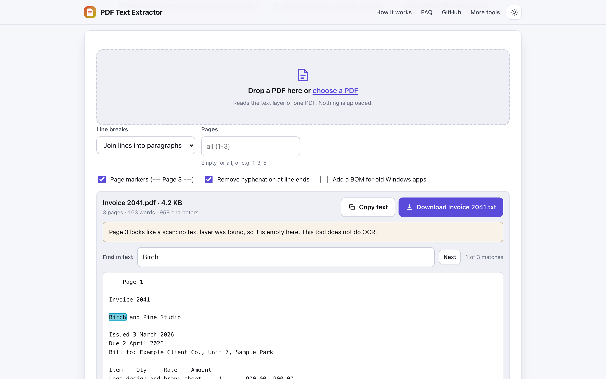
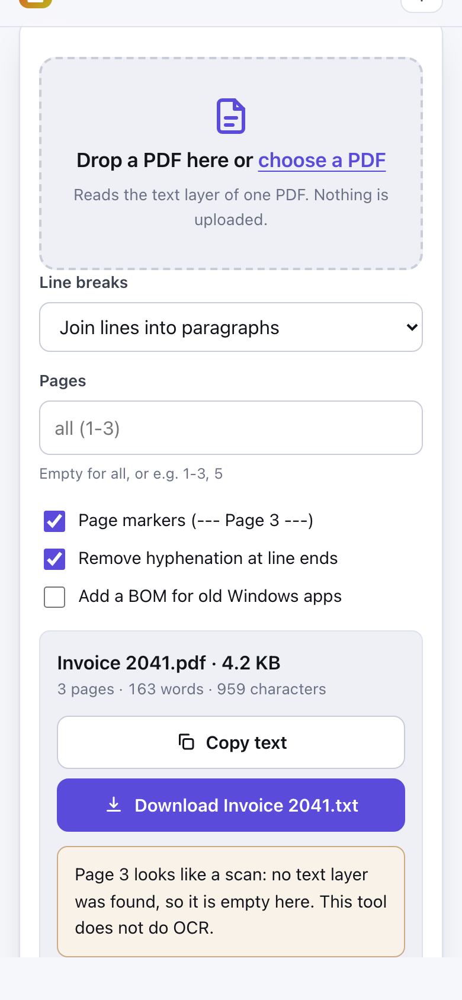

# PDF Text Extractor

> Copy or save all the text from a PDF as a TXT file in your browser, with nothing uploaded.

**🌐 Use it now: [turhe123.github.io/pdf-text-extractor](https://turhe123.github.io/pdf-text-extractor/)** · free · open source · runs in your browser · works offline


## Why

PDF Text Extractor is a free, open-source alternative to Adobe Acrobat online and Smallpdf PDF to Text (which upload your files, ask you to sign in after a free try, and charge for OCR on scanned pages). Here your files never leave the device, there is no account, no ads and no limits, it works offline, and you can install it as an app.

## Screenshots

<p align="center"></p>

<p align="center"><em>PDF Text Extractor in the browser, light theme</em></p>

<p align="center"></p>

<p align="center"><em>PDF Text Extractor on a phone</em></p>

## Features

- Extracts the text layer of a PDF and shows it in a read-only text area, with a stats line (pages, words, characters).
- Drag and drop or pick one PDF; the file is read entirely on your device.
- Line breaks: join wrapped lines into paragraphs (default) or keep lines as laid out.
- Page markers (`--- Page 3 ---`) between pages, on by default.
- Removes hyphenation at line ends (on by default).
- Page range such as `1-3, 5` (empty means all pages); changing options re-renders without re-reading pages already extracted.
- Copy to clipboard, with a select-and-copy fallback for browsers that block the clipboard API.
- Download as a UTF-8 `.txt` named after the PDF, with an optional BOM for old Windows apps.
- Search box that highlights all matches and shows a count; Enter jumps to the next match, Shift+Enter to the previous one.
- Pages without a text layer (scans) are listed in a note. There is no OCR.
- Password-protected PDFs: asks for the password and unlocks the file in your browser. It does not bypass passwords.
- Progress bar and a Cancel button for long documents; partial text stays available.
- Inline error messages for files that are not PDFs or are damaged.
- Keyboard friendly: Ctrl/Cmd+A inside the result selects all the text.
- Light and dark themes, responsive layout, installable PWA.

**Input:** one `.pdf` file at a time (if you drop several, the first is used).
**Output:** plain text (copy or UTF-8 `.txt`).
**Limits:** no file size cap, but very large files are limited by your device's memory. Only selectable text is extracted, and text in several columns may come out interleaved line by line.

## How to use

1. Open the page and drop a PDF on it, or choose one.
2. Adjust the options: line breaks, page markers, hyphenation, page range.
3. Check the text, and use the search box to find what you need.
4. Click **Copy text** or **Download TXT**.

## Privacy

- Nothing is uploaded. The PDF is read and processed in your browser.
- No cookies.
- Page views are counted anonymously with [GoatCounter](https://www.goatcounter.com/) (cookieless, open source).
- Works offline after the first visit through a service worker.

## Run it locally

```sh
git clone https://github.com/turhe123/pdf-text-extractor
cd pdf-text-extractor
python3 -m http.server 4173
```

Then open http://127.0.0.1:4173/. There is no build step.

## Tests

```sh
npm i -D @playwright/test && npx playwright install chromium
npx playwright test
```

## Third-party code

| Library | Version | License |
| --- | --- | --- |
| [pdf.js](https://github.com/mozilla/pdf.js) (`pdfjs-dist`) | 4.10.38 | Apache-2.0 |

## Built with AI

PDF Text Extractor was written by [Claude Code](https://claude.com/claude-code) inside an automated pipeline, from a plain-English spec. No code or assets from any commercial product were used; it is a clean-room implementation of a feature set, not a copy.

What that means in practice:

- The full source is in this repo under the MIT license. Read it before you trust it with your files.
- Everything runs in your browser. It makes no network requests except an anonymous, cookieless page-view count (GoatCounter); your files never leave the device.
- The page is tested headless in Chromium (Playwright) before every release, but it has had less human review than hand-written software. Bug reports and pull requests are welcome.

## Support ❤️

If this saved you time or a subscription, you can support the project on [Ko-fi](https://ko-fi.com/leodavidai).

## More free web tools

See the rest at [turhe123.github.io/web-tools](https://turhe123.github.io/web-tools/).

## License

MIT © Or Davidai Bachar
